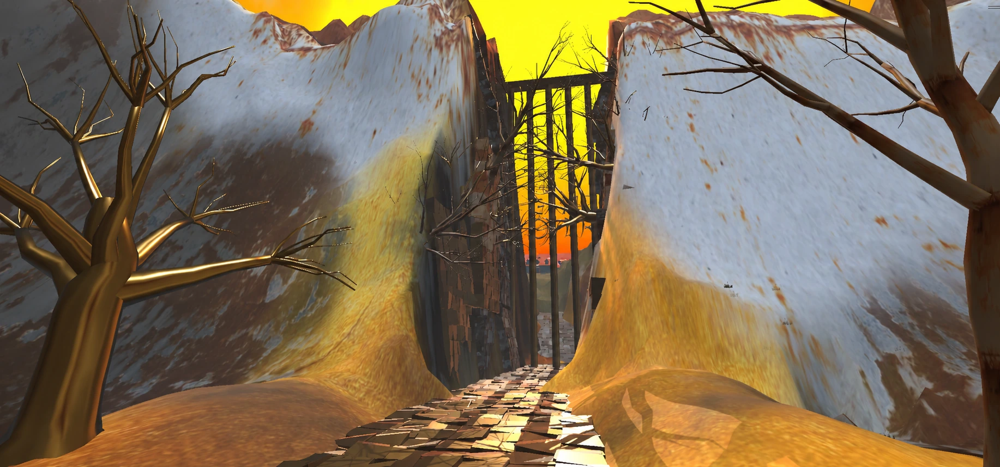
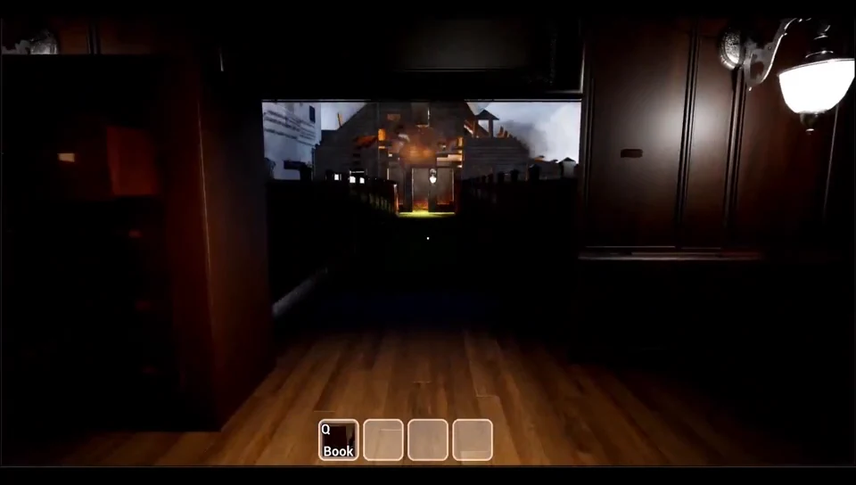

<h1 align="center">你好，我是胡哲瀚 👋</h1>

  

  <a href="https://siempre-2004.github.io/"><strong>🎮 看我的作品集</strong></a>
  &nbsp;·&nbsp;
  <a href="https://zhehanhu.creght.site/">原作品集网站</a>
  &nbsp;·&nbsp;
  <a href="https://www.linkedin.com/in/zhehan-h-4b0a01293/">LinkedIn</a>
  &nbsp;·&nbsp;
  <a href="mailto:huzhehanhuzhehan@gmail.com">联系我</a>

## 关于我

我叫胡哲瀚，毕业于乌普萨拉大学游戏设计专业。

我用 Unity、Unreal 和 C++ 做游戏，做过叙事解谜、关卡设计、狼羊生态模拟，也和团队一起做过用自制钓竿控制的街机。我喜欢把想法做出来，再看看实际玩起来是什么感觉：玩家能不能找到路、看懂提示，角色的动作和反馈是否合适。

在团队项目里，我写过玩法和交互逻辑，也为游戏创作音乐；自己的小项目则更多用来练习寻路、状态机、碰撞检测和地图渲染。目前希望寻找游戏设计或游戏开发相关的机会。

## 做过的一些项目

### Limbo · 边缘世界

**Unity / C# / 关卡设计**

玩家在一个由记忆和欲望构成的世界里寻找套娃，集齐后打开出口。我搭建关卡，用灯光、地标和物件引导玩家探索，也编写了收集、重生和场景切换的逻辑。

[图文详情](https://siempre-2004.github.io/projects/limbo.html) · [项目网站](https://limbohu.creght.site/) · [看代码](https://github.com/siempre-2004/Limbo)

### Echoes of Silence

**Unreal Engine / Blueprint / 团队项目**

一款围绕记忆展开的第一人称解谜游戏，包含滑块锁、故事柜和摩斯电码等谜题。我编写故事内容、制作部分 Blueprint 交互逻辑，并创作游戏音乐。项目页里放了不同版本的截图，可以看到线索和谜题是怎样一步步调整的。

[图文详情](https://siempre-2004.github.io/projects/echoes-of-silence.html) · [项目网站](https://intramentem.creght.site/) · [看代码](https://github.com/siempre-2004/IntraMentem)

### The Dual-Hatted Courtier · 双重身份的信使

**Unity / Arduino / 团队项目**

这是我们做的一款实体街机。玩家用自制钓竿和颜色传感器操作游戏中的信使，在村庄里躲避守卫、完成收集任务。我主要做装置输入接入、文字交互和部分场景逻辑，也制作了游戏音乐。

[图文详情](https://siempre-2004.github.io/projects/arcade.html) · [项目网站](https://arcadehu.creght.site/) · [看代码](https://github.com/siempre-2004/Arcade_Game)

### AI Prairie · 狼羊生态模拟

**C++ / raylib / 游戏 AI**

羊会找草、逃跑和繁殖，狼会追逐目标，草地也会生长。我用状态机决定它们当前要做什么，再用 A* 计算路线。运行时可以查看实体状态、观察路径，也可以修改地图，看看它们怎样应对变化。

[图文详情](https://siempre-2004.github.io/projects/ai-prairie.html) · [项目网站](https://ecosystemhu.creght.site/) · [看代码](https://github.com/siempre-2004/EcoSystem_VisualStudio)

### SkyTiles · 瓦片地图原型

**C++ / raylib**

这个项目用来练习地图读取、相机控制和可见性判断。可以切换三种大小的地图、锁定相机范围、重新分布瓦片，观察地图规模和画面之间的关系。

[图文详情](https://siempre-2004.github.io/projects/skytiles.html) · [项目网站](https://huskytiles.creght.site/) · [看代码](https://github.com/siempre-2004/SkyTiles_VisualStudio)

### 其他尝试

- **Four Kingdoms · 四国**：围绕联盟与背叛设计的桌游，尝试让合作有好处，也需要承担风险。[图文详情](https://siempre-2004.github.io/projects/four-kingdoms.html) · [项目网站](https://hufourkingdoms.creght.site/)
- [小游戏与碰撞实验](https://siempre-2004.github.io/projects/mini-games.html)：章鱼射击、小行星游戏，以及 AABB、SAT 碰撞检测练习。
- [曲线引导网格编辑](https://siempre-2004.github.io/projects/mesh-editing.html)：一个 Python 几何处理原型，尝试通过移动曲线来调整周围曲面。

## 一些项目画面

| Limbo | Echoes of Silence |
| --- | --- |
|  |  |

## 常用工具

C++、C#、Python；Unity、Unreal Engine、raylib；Arduino、Git、Jira。游戏音乐主要用 Logic Pro 制作。

## 联系我

欢迎交流游戏设计和开发，也欢迎联系我聊合适的工作机会。

- 邮箱：[huzhehanhuzhehan@gmail.com](mailto:huzhehanhuzhehan@gmail.com)
- 作品集：[siempre-2004.github.io](https://siempre-2004.github.io/)
- 原作品集网站：[zhehanhu.creght.site](https://zhehanhu.creght.site/)

网站内容和视频的更新方法见 [维护说明](docs/site-maintenance.md)。
