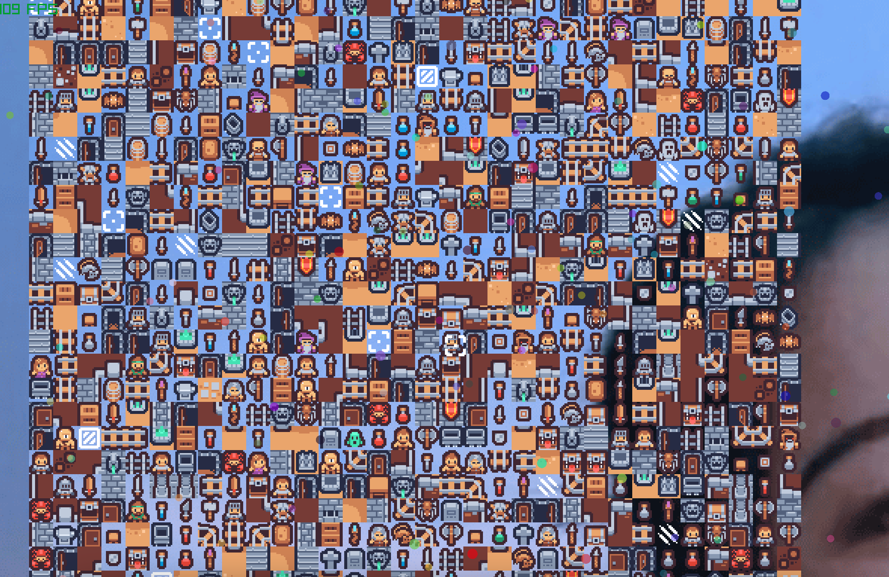
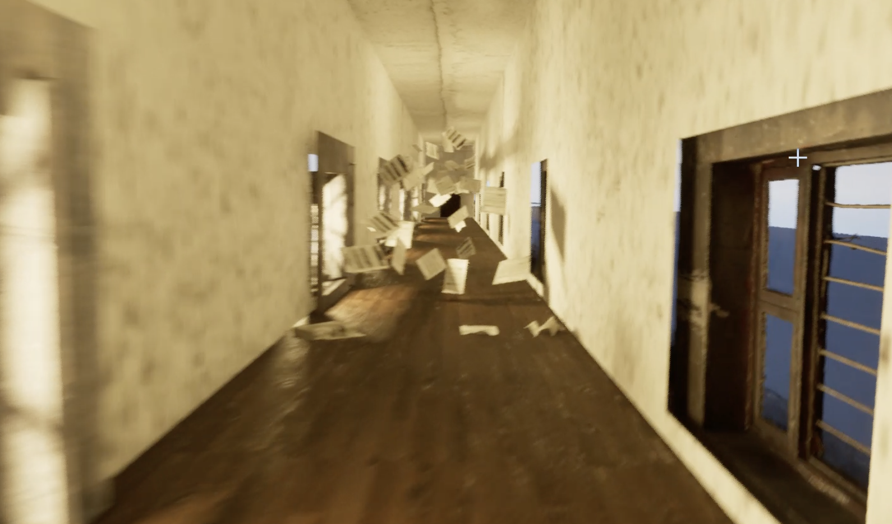

<h1 align="center">Hi, I'm Zhehan Hu 👋</h1>

  

  <a href="https://siempre-2004.github.io/"><strong>🎮 Explore My Portfolio</strong></a>
  &nbsp;·&nbsp;
  <a href="https://github.com/siempre-2004">GitHub</a>
  &nbsp;·&nbsp;
  <a href="https://www.linkedin.com/in/zhehan-h-4b0a01293/">LinkedIn</a>
  &nbsp;·&nbsp;
  <a href="mailto:huzhehanhuzhehan@gmail.com">Email</a>

---

## About Me

I have a background in **game design** and work across **gameplay programming, graphics prototypes, and interactive systems**.

I enjoy understanding both sides of an experience: the systems that make it work, and the design decisions that make it feel right.

- 🎮 Gameplay systems, level design, and player interaction
- 🌱 Game AI, finite state machines, and pathfinding
- 🧩 Real-time graphics and geometry-processing experiments
- 🎵 Original game music

I'm interested in opportunities involving **gameplay programming, technical prototyping, and interactive experiences**.

## Tools & Technologies

| Area | Tools and topics |
| --- | --- |
| Programming | C++ · C# · Python |
| Game development | Unity · Unreal Engine · Blueprint |
| Graphics & simulation | raylib · Tile rendering · Camera systems |
| Game AI | Finite state machines · A* pathfinding |
| Physical interaction | Arduino · Custom controllers |
| Collaboration | Git · Jira · Sourcetree |

## Selected Projects

### 🌱 AI Prairie

**C++ · raylib · Finite State Machines · A***

A predator–prey simulation where sheep, wolves, grass, and a player-controlled herder interact through changing states and pathfinding.

- State-driven grazing, wandering, reproduction, and escape
- A* navigation for pursuing targets
- Debug views for inspecting entity states and paths
- Editable terrain and obstacles

[Source Code](https://github.com/siempre-2004/EcoSystem_VisualStudio) · [Project Walkthrough](https://ecosystemhu.creght.site/)

### 🗺️ SkyTiles

**C++ · raylib · Real-time Graphics**

A tile-rendering prototype exploring map scale, camera controls, and visibility.

- Switch between 32 × 32, 128 × 128, and 1024 × 1024 tile maps
- Toggle frustum culling and camera locking
- Constrain the camera to map bounds
- Redistribute tiles to explore different arrangements

[Source Code](https://github.com/siempre-2004/SkyTiles_VisualStudio) · [Project Walkthrough](https://huskytiles.creght.site/)

### 🧭 Limbo

**Unity · C# · Level Design**

A level-design project exploring player guidance, environmental storytelling, and puzzle progression.

**My contributions include:**

- Level layouts and environment building
- C# gameplay scripting and puzzle activation
- Collectible-state management and scene transitions
- Environment interactions, respawn systems, and debugging

[Source Code](https://github.com/siempre-2004/Limbo) · [Level Design Walkthrough](https://limbohu.creght.site/)

### 🧠 Intra Mentem

**Unreal Engine · Blueprint · Team Project**

A first-person psychological puzzle game about memory and reconstruction.

The project combines environmental storytelling, symbolic puzzle rooms, interactions integrated into the game world, and an audio-based Morse code puzzle.

[Source Code](https://github.com/siempre-2004/IntraMentem) · [Project Walkthrough](https://intramentem.creght.site/)

### More Work

| Project | Focus | Links |
| --- | --- | --- |
| **The Dual-Hatted Courtier** · Team project | A physical–digital stealth arcade game using Unity and an Arduino fishing-rod controller with a color sensor. | [Code](https://github.com/siempre-2004/Arcade_Game) · [Project](https://arcadehu.creght.site/) |
| **Four Kingdoms** | A tabletop game exploring cooperation, player decisions, and rule-driven systems. | [Project](https://hufourkingdoms.creght.site/) |
| **Curve-guided Mesh Editing** | An early geometry-optimization prototype for local mesh deformation, with constraints on curve error, boundary drift, and smoothness. | [Code](https://github.com/siempre-2004/curve-guided-mesh-editing) |

## A Glimpse of My Work

| SkyTiles | Intra Mentem |
| --- | --- |
|  |  |

## Let's Connect

I'm interested in building games and interactive experiences that connect technical systems with thoughtful design.

- **Portfolio:** https://siempre-2004.github.io/
- **Email:** huzhehanhuzhehan@gmail.com
- **LinkedIn:** [Zhehan Hu](https://www.linkedin.com/in/zhehan-h-4b0a01293/)

<strong>中文简介</strong>

我是胡哲瀚，具有游戏设计背景，项目涉及玩法编程、图形原型与交互系统。

我使用 C++、C#、Python、Unity、Unreal Engine 和 raylib，关注游戏规则如何运行，以及玩家如何理解和体验这些系统。

目前希望寻找与游戏开发、技术原型和交互体验相关的机会。

---

  <strong>A little code. A whole world.</strong>

